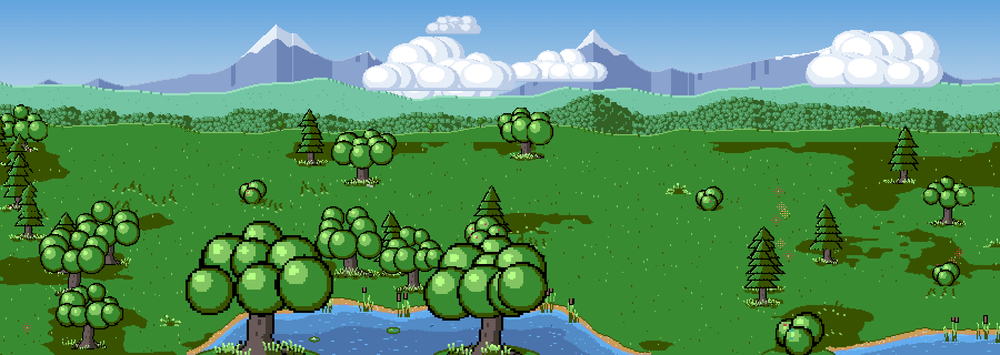
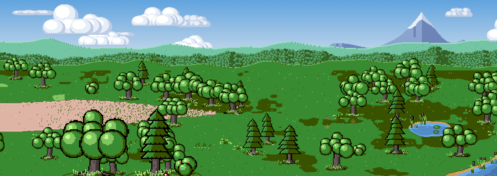
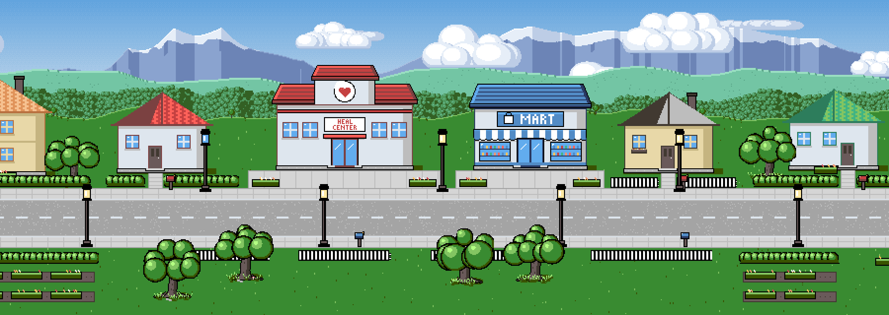
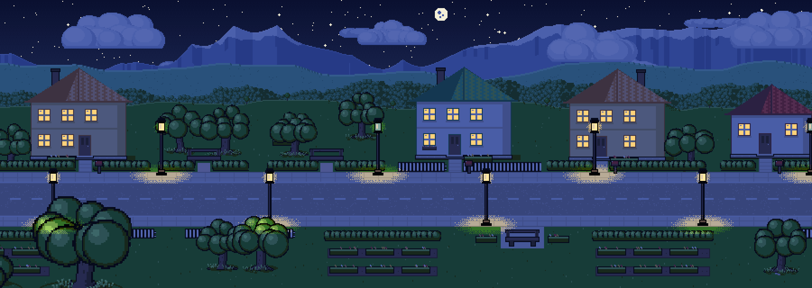
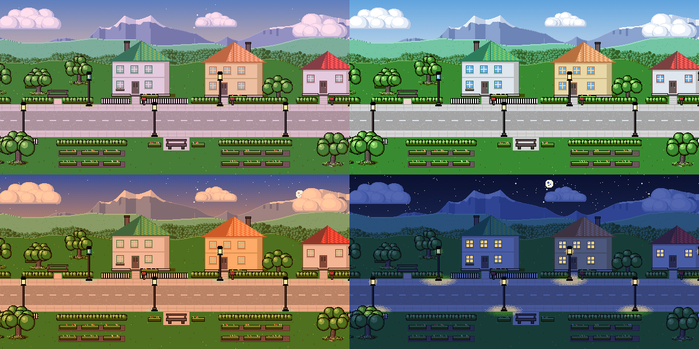
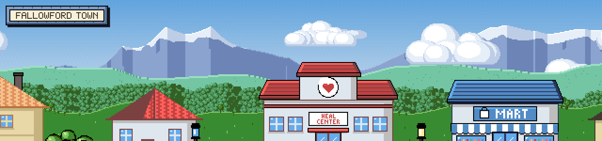
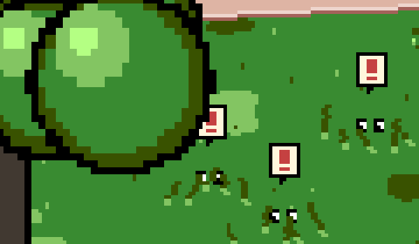
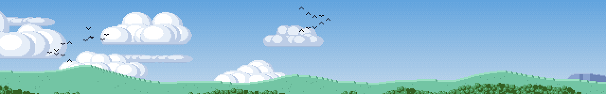
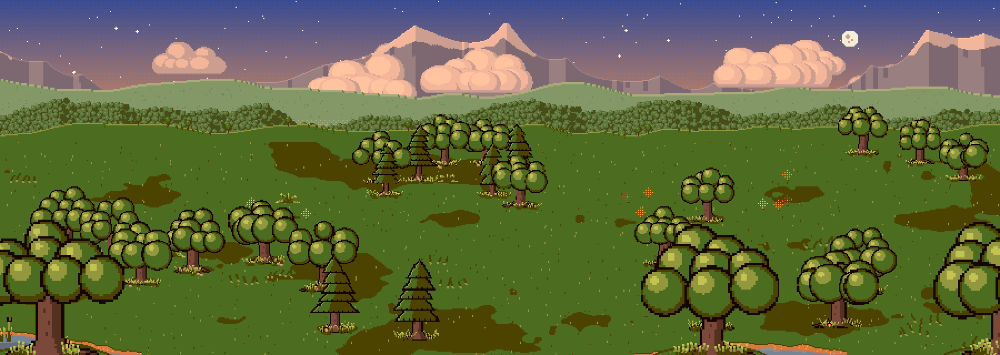

# Emerald Field

An endless, procedurally generated pixel-art landscape you can wander through, in the spirit of the Game Boy Advance era of monster-collecting RPGs. Every route, grove, town, lake, cloud and mountain range comes from a single seed. There are no image assets: everything is drawn in code, pixel by pixel, from a small indexed palette (about 70 colors plus a 16-step sky gradient).



## Gallery

**Forest routes.** Groves of broadleaf and conifer trees, ferns and fallen logs, a dirt trail that narrows and fades out among the trees, and small field ponds.



**Towns.** Planned towns along a paved street: houses with fenced yards and mailboxes, a healing center and a mart side by side mid-town, street lamps, gardens and bench nooks.



**Day and night.** A full day cycle: dawn, day, dusk and night. After dark the windows light up, the street lamps cast warm pools of light, and stars and the moon come out.





**Area names.** Every town has its own generated name, lettered on the signs at the town limits. Between towns, the countryside is split into numbered routes. A location banner slides in whenever you cross into a new area: a stone frame for towns, a wooden one for routes.



**Something in the grass.** Now and then a tuft of tall grass rustles, and a pair of eyes peeks out between the blades. Tap a tuft to see who's home.



**Life in the sky.** Flocks of birds cross overhead in V-formations or loose bunches, now and then a large bird soars past on outstretched wings, and after dusk bats flutter across the stars. They're silhouettes only, flying at their own depth: a low flock can dip behind the hills.



**The backdrop.** Snow-capped mountain ranges, hazy far hills, forested mid hills and rolling foothills, each scrolling at its own parallax speed, with mist in the valleys and clouds drifting between the layers.



## Features

- **Infinite, seeded world**: the same seed always produces the same world, generated in chunks as you scroll.
- **Regions**: open routes, dense forest and towns, blended smoothly along the way.
- **Trees that grow out of the ground**: every tree is unique (canopy shape, lean, trunk flare and roots), with shadows and grass tufts around its base. Trees cluster into groves with clearings in between.
- **Depth**: everything standing on the ground is drawn back to front, and a per-pixel depth buffer keeps swaying canopies and grass behind anything in front of them.
- **Water**: lakes and ponds with shallows and deep water, a sandy shoreline all the way round, reflections, ripples, lapping foam, lily pads, reeds, and fish that surface in spreading rings or leap out of the water and splash back in.
- **Towns**: one deterministic lot plan per town, so every chunk agrees on where each building, fence, tree and lamp goes.
- **Sky**: pixel-art cumulus and stratus clouds in three parallax layers, and a layered landscape of mountains, hills and meadows.
- **Area names**: original generated town names (checked against the games' real town names so none ever match), numbered routes between towns, named town-limit signs, and a GBA-style location banner on entering each area.
- **Wild encounters**: occupied tufts of tall grass rustle, shed leaves and show a pair of peeking eyes (glowing after dark) under an alert bubble, and tapping any tuft sets one off.
- **Flying silhouettes**: bird flocks (V-formations and loose bunches), lone soaring birds and night-time bats, each with a wing-flap cycle, crossing the sky on a parallax layer between the hills.
- **Hidden items**: about half of the countryside hides an item in the grass, marked only by an occasional glint. Tap it to pick it up (a berry, a shiny stone, honey and more). Finds are remembered per world in your browser.
- **Time of day**: the palette is re-tinted through dawn, day, dusk and night, with emissive lamps, lit windows, stars and a moon.
- **Smooth scrolling**: eased motion with momentum, plus an idle-time buffer that generates the world just ahead of the view so new chunks never stall a frame.

## Controls

| Input | Action |
| --- | --- |
| Hold `←` / `→` | Walk (speeds up, coasts to a stop) |
| Drag | Pan the view (flick to keep gliding) |
| Tap tall grass | Disturb whatever's hiding in it |
| Tap a glint | Pick up a hidden item |
| `◀` / `▶` | Glide a short way |
| Time button | Jump to the next time of day |
| `✦ new` | Generate a new world |
| `↓ png` | Save a screenshot |

URL parameters:

- `?seed=anything` picks the world. The seed is kept in the URL, so you can share a link to a world.
- `?time=dawn|day|dusk|night` sets the starting time of day.

## Running it

Requires Node.js 22.12 or newer (for the Vitest version used).

```sh
npm install
npm run dev      # start the dev server (Vite)
npm test         # run the test suite (Vitest)
npm run build    # type-check and build for production
```

## How it works

The world is drawn into a low-resolution framebuffer of **palette indices** (320 pixels tall), then scaled up with nearest-neighbour sampling for the crisp pixel look. Storing indices instead of colors is what makes the day and night cycle cheap: each frame is colored through the palette for the current hour on its way to the screen.

| Module | What it does |
| --- | --- |
| `src/world/worldgen.ts` | Chunk generation: ground, paths and trails, lakes and ponds, and placement of everything that stands on the ground, depth-sorted into each chunk with a depth buffer |
| `src/world/town.ts` | Finds each town's extent and lays out its lots, in world space |
| `src/world/backdrop.ts` | The parallax mountains, hills and meadows, cached in strips |
| `src/world/clouds.ts` | Parallax cloud layers, laid out in world space, drifting with the wind |
| `src/world/water.ts`, `waterfx.ts` | Water painting, plus the per-frame reflections, ripples, foam and fish rings |
| `src/world/renderer.ts` | Draws the frame: sky, backdrop, chunks, swaying canopies and grass, water, foreground. Also handles lamplight, the night sky and idle-time prefetching |
| `src/core/daylight.ts` | The time-of-day palettes |
| `src/sprites/` | Procedural sprites: trees, plants, buildings, street furniture, clouds |

Generation is fully deterministic, and a golden-hash test locks in the exact pixels for a spread of seeds. If a refactor changes a single pixel, the test catches it.

## Disclaimer

Emerald Field is an unofficial fan project, inspired by the look of Game Boy Advance-era RPGs. It is not affiliated with, endorsed by, or connected to Nintendo, Game Freak, Creatures Inc. or The Pokémon Company. It contains no game assets: every sprite and scene is generated procedurally by this code. Pokémon and related names are trademarks of their respective owners.
